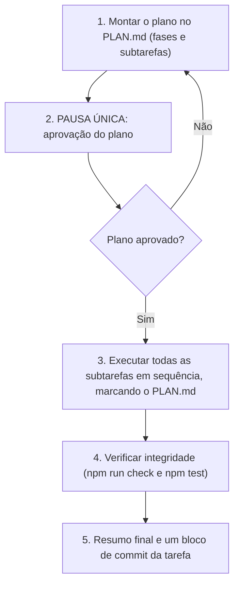

# Guia e Guardrails para Desenvolvimento com IA — PedMesa (backend)

Regras inegociáveis, padrões e protocolo de trabalho obrigatório para qualquer agente de IA que atue neste repositório. A arquitetura, os requisitos e o andamento do projeto ficam em `docs/` (`ARQUITETURA.md`, `REQUISITOS.md` e `ANDAMENTO.md`) e devem ser lidos antes de propor mudanças.

> [!IMPORTANT]
> **A IA nunca executa escrita no Git e nunca começa a codar sem o plano aprovado.** O plano é aprovado uma única vez; depois disso, a IA executa todas as subtarefas em sequência e entrega um único bloco de commit no fim.

---

## 1. Princípio fundamental de operação

O agente atua em regime de **pair programming supervisionado**. O papel dele é acelerar a implementação mantendo precisão arquitetural, tipagem estrita e segurança.

- **Menor alteração possível:** altere estritamente o necessário para cumprir os critérios de aceite. Não refatore trechos não relacionados sem pedido.
- **Respeito a tipos e contratos:** mantenha a compatibilidade com os DTOs, mappers e contratos da API (`snake_case` nas respostas). O frontend e o agente de impressão dependem deles.
- **Tratamento de erros:** não engula exceções nem devolva respostas silenciosas. Falha de regra vira `AppError` com status semântico; falha inesperada sobe até o `errorHandlerMiddleware`.
- **Segurança:** nunca grave senha, token, segredo de JWT ou URL de ambiente no código; use sempre variáveis do `.env`. Antes de escrever ou revisar endpoint, service, query, migration ou validação de entrada, siga a skill `secure-coding-guidelines` (isolamento multi-tenant, RBAC, transações e desconfiança de valores vindos do cliente).

---

## 2. Protocolo de entrada de tarefas (Jira e contexto)

O rastreador é o Jira, projeto **PED**, no site `samuelramos.atlassian.net`. Ao receber uma demanda ou chave (ex.: `PED-85`):

1. **Consulta via MCP:** leia a issue para extrair título, descrição, critérios de aceite, tipo, épico pai e status. Sem card, pergunte qual é antes de implementar algo grande.
2. **Escopo estrito do card:** o trabalho fica dentro da descrição e dos critérios de aceite. Melhorias, refatorações ou bugs encontrados fora do escopo são **relatados e sugeridos como um novo card**, não implementados junto. Se o card estiver ambíguo ou em conflito com o código, aponte o conflito e pergunte.
3. **Contexto complementar:** consulte `docs/` (`REQUISITOS.md`, `ARQUITETURA.md`, `ANDAMENTO.md`) e as ADRs em `docs/adr/`.
4. **Planejamento no `PLAN.md`:** copie `.agents/PLAN.md.example` para `.agents/PLAN.md` (local, ignorado pelo Git) e estruture fases e subtarefas antes de alterar código.
5. **Alinhamento:** apresente o entendimento da demanda, a lista exata de arquivos que serão criados ou editados e o comando da branch (seção 4).

---

## 3. Execução com aprovação única do plano



- As subtarefas do `PLAN.md` organizam e registram o trabalho; **não geram pausas nem commits**.
- Ao apresentar o plano, entregue junto o comando da branch (seção 4) e termine com a pergunta: _"Plano da tarefa [PED-ID] pronto. Posso executar?"_
- Depois da aprovação, só pare antes do fim se algo bloquear, se um critério de aceite não puder ser cumprido ou se o plano precisar mudar de escopo.
- Rode `npm run check` e os testes ao longo do caminho, não só no fim.
- No fim, apresente o resumo, os arquivos criados e alterados, o resultado da verificação e o bloco de commit único.

---

## 4. Git, branches e commits

### Somente comandos manuais

- A IA está **proibida** de executar comandos de escrita no Git (`git commit`, `git push`, `git checkout -b`, `git switch -c`, `git merge`, `git rebase`, `git reset`, `git tag`, `git stash` etc.), mesmo quando a mudança parece pronta. Comandos de leitura (`git log`, `git branch -a`, `git show`) são permitidos para a IA se orientar.
- Toda ação Git é entregue em um **bloco de código** para o desenvolvedor executar. O bloco contém só `git add`, `git commit` e `git push` (e `git checkout -b` quando for criar a branch). Não inclua `git status` nem `git diff` nos blocos nem nos checklists.
- `pedmesa-backend`, `pedmesa-frontend`, `pedmesa-site` e `pedmesa-print-agent` são repositórios separados. Quando a tarefa mexe em mais de um, o bloco usa `git -C <repositório>` e traz um commit para cada repositório.

### Branches: uma por épico

- O fluxo é o GitLab Flow (ver `docs/GITFLOW.md`): toda branch sai da `main` mais recente.
- A branch é do **épico**, não da tarefa: `PED-<ID-do-épico>-<titulo-do-epico-em-slug>`, em minúsculas, com hífens e sem acentos. Ex.: `PED-53-validacao-e-hardening-de-seguranca`, `PED-80-delivery-modelagem-de-banco`.
- Todas as tarefas do épico são commitadas nessa branch. Antes de sugerir o comando, confira com `git branch -a` se ela já existe: se existir, oriente a troca para ela; se não, entregue o `git checkout -b` a partir da `main`.

### Commits: um por tarefa

```text
<tipo>(<escopo>): [PED-<ID>] <descrição no imperativo, em português>
```

- **Um commit por tarefa**, nunca um por subtarefa. A mensagem descreve a tarefa inteira; o tipo é o da mudança principal (código, testes e docs da mesma tarefa vão juntos).
- A chave é a da **tarefa** (não a do épico) e fica logo depois dos dois-pontos. Ex.: `feat(delivery): [PED-85] cria tabela de clientes`.
- **No máximo 100 caracteres** no total; acima disso o Commitlint rejeita.
- Tarefa sem card no Jira: omita o `[PED-<ID>]`.
- **Nada de `Co-Authored-By`** nem qualquer atribuição de IA na mensagem.

| Tipo       | Quando usar                                            |
| ---------- | ------------------------------------------------------ |
| `feat`     | Nova funcionalidade ou endpoint                        |
| `fix`      | Correção de bug ou comportamento inesperado            |
| `refactor` | Mudança estrutural sem alterar o comportamento externo |
| `chore`    | Configuração, dependências, build, tooling             |
| `docs`     | Somente documentação                                   |
| `test`     | Criação ou ajuste de testes                            |

Escopo: o módulo ou a funcionalidade (`delivery`, `comandas`, `pedidos`, `impressao`, `auth`, `admin`...).

### O que não fazer

- Não criar templates de PR nem de Issue (`.github/pull_request_template.md`, `.github/ISSUE_TEMPLATE/`). As tarefas ficam no Jira.
- `.agents/PLAN.md` nunca vai para commit; o versionado é o `PLAN.md.example`, em branco.

---

## 5. Tipagem estrita

- O backend roda com `"strict": true`, e isso não muda. **`any` é proibido.**
- Dado de fora (body, query, params, resposta externa) entra como `unknown` e é estreitado por type guard, como fazem os DTO validators (`assertValid…Dto`). O projeto não usa Zod; não introduza uma segunda forma de validar.
- Evite `as Tipo` para silenciar o compilador. Um `as` só é aceito logo depois de uma checagem que já garante o tipo (por exemplo, depois de conferir que o valor está na lista de valores do enum). Prefira `satisfies` e type guards (`value is T`).
- Todo código entregue passa no `npm run check` (`tsc` do código e dos testes, mais Biome com `--error-on-warnings`).

---

## 6. Idiomas do projeto

| Item                                                                                                   | Idioma                        |
| ------------------------------------------------------------------------------------------------------ | ----------------------------- |
| Comentários, commits, documentação, `PLAN.md` e conversa                                               | Português (Brasil)            |
| Nomes de branch                                                                                        | Português, sem acentos        |
| Nomes do domínio no código (`comanda`, `calcularTroco`, `numeroEntrega`, `assertTransicaoValida`)      | Português, como já é o padrão |
| Sufixos e termos técnicos (`*.service.ts`, `*.controller.ts`, `*.mapper.ts`, `*.dto.ts`, `Repository`) | Inglês                        |
| Rotas HTTP (`/comandas`, `/pedidos`), campos do contrato (`snake_case`) e mensagens ao usuário         | Português (Brasil)            |

---

## 7. Documentação em dia

Quando a alteração mudar comportamento, rotas, variáveis de ambiente, modelo de dados ou fluxos, atualize `README.md`, `docs/ARQUITETURA.md` e, se couber, `docs/REQUISITOS.md` e `docs/ANDAMENTO.md` na mesma entrega, e inclua esses arquivos na lista do plano.

---

## 8. Guardrails de arquitetura do backend (Express 4, TypeORM e PostgreSQL)

Este repositório é **somente a API REST** (`/api/v1`). As telas ficam em `pedmesa-frontend`, a landing page em `pedmesa-site` e a impressão local em `pedmesa-print-agent`. Detalhes de camadas, modelo de dados e autenticação estão em `docs/ARQUITETURA.md`.

Valem para todo código novo e para qualquer código que você mexer. Parte do código antigo é anterior a estas regras: não copie o padrão antigo; ajuste-o quando precisar alterá-lo de qualquer forma.

1. **Camadas por módulo** (`src/modules/<modulo>/`: `routes → controllers → services → entities`, com `dtos/` e `mappers/`):
   - O **controller** faz exatamente três coisas: valida o body com o DTO validator (`assertValid…Dto`), chama o service e responde por um mapper (`to…Response`, campos em `snake_case`). Nada de regra de negócio, acesso a repository ou `try/catch` para controle de fluxo.
   - **Uma entidade do TypeORM nunca chega ao `res.json()`**, nem "só desta vez". Sempre passe pelo mapper.
   - Nova rota: crie route, controller, DTO, service e mapper no módulo; monte o router em `src/app.ts` sob `/api/v1`; defina o acesso com `authMiddleware` e `rbacMiddleware([...])`; permissões finas por usuário seguem o padrão de `permissao.middleware.ts` (ex.: `requirePodeExcluirItemFechamento`). O agente de impressão usa `agentAuthMiddleware` (token do agente, não JWT) e o painel de super-admin usa `superAdminAuthMiddleware`.
2. **Regras de negócio em funções puras:** cálculos e decisões (dinheiro, troco, descontos, transições de status, guardas) ficam em `*-calculator.ts` ou `*-transition.ts` ao lado do service, com um `*.test.ts` junto. Esses arquivos **não importam `typeorm` nem `AppDataSource`**: recebem dados simples e devolvem dados simples ou lançam `AppError`. Referências: `fechamento-calculator.ts`, `desconto-calculator.ts`, `item-status-transition.ts`. Máquinas de estado usam uma única tabela `TRANSICOES_VALIDAS`.
3. **Escrita em várias tabelas é uma transação só:** toda operação que grava em mais de uma tabela roda dentro de um único `AppDataSource.transaction(async (manager) => …)`. Etapas reaproveitáveis recebem o `EntityManager` por parâmetro em vez de abrir a própria transação. Efeitos que saem do banco (fila de impressão, chamadas externas) rodam **depois** do commit.
4. **Isolamento por tenant:** toda query filtra por `tenant_id`, diretamente ou por join com uma tabela do tenant. O tenant vem do token (`getTenantId(req)`), nunca de um valor enviado pelo cliente. As tabelas do delivery usam FKs compostas com `tenant_id`.
5. **Dinheiro:** toda conta passa por `toCents`/`fromCents` (`src/shared/utils/money.ts`). Nunca faça aritmética em ponto flutuante sobre `preco`/`valor`.
6. **Reaproveite antes de criar:** `toCents`, `isUuid`, `isUniqueViolation`, `getTenantId`, `getUserId` e `apenasDigitos` já existem em `src/shared/utils`.
7. **Migrations:**
   - Mudanças aditivas: adicione a coluna como nullable, preencha com `UPDATE ... FROM` em SQL puro e só então aperte as constraints.
   - **Nunca rode `npm run migration:revert` em sequência.** Para testar um `down()`, rode a migration num `QueryRunner` dentro de `startTransaction()` e sempre `rollbackTransaction()`.
   - Antes de numerar uma migration nova, confira o maior número em **todas** as branches (`git ls-tree --name-only <branch> src/database/migrations/`).
   - `changeColumn` no Postgres pode recriar a coluna e apagar os dados. Para mudar só `NULL`/`NOT NULL`, use `ALTER COLUMN` em SQL direto.
   - No `down()`, não deixe o `dropTable` remover enums que outra tabela usa.
   - **O `.env` aponta para o Postgres de desenvolvimento na VPS**, compartilhado. Migrations de produção nunca são rodadas a partir deste ambiente.
8. **Testes:**
   - Lógica pura: teste unitário ao lado do arquivo (`src/**/*.test.ts`, projeto `unit` do Vitest).
   - Integração HTTP: `tests/**/*.test.ts` com Supertest, contra o banco descartável do `docker-compose.test.yml`. A suíte recusa rodar se `DB_NAME` não terminar em `_test`. Nunca aponte testes para o banco da VPS.
   - Entidade nova fica em `src/modules/<modulo>/entities/*.entity.ts` e migration em `src/database/migrations/`: a suíte de integração entrega ao TypeORM as classes carregadas pelo Vite a partir desses caminhos (`tests/setup/typeorm-modules.ts`), porque o `require` nativo do Node não carrega TypeScript com `enum`.
9. **Impressão:** a tabela `fila_impressao` alimenta o `ImpressaoService` e o agente desktop. Mudar o payload de um job ou criar um `tipo` novo exige a mesma mudança no formatador do `pedmesa-print-agent`.
