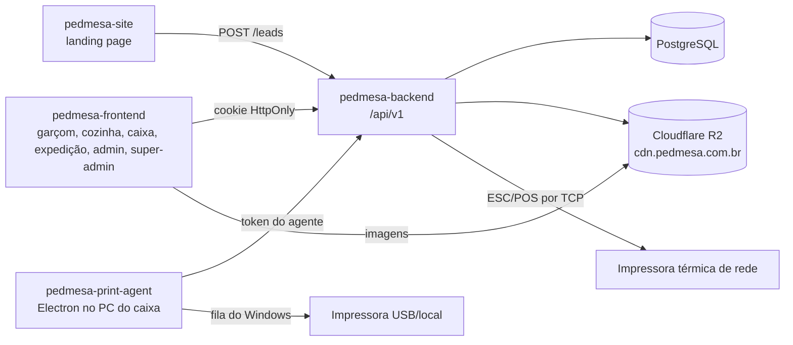
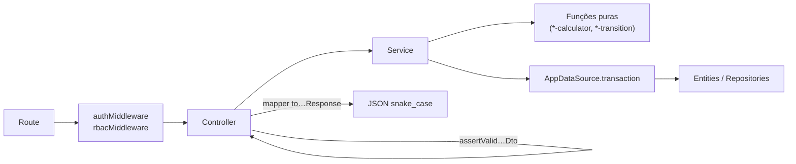

# Arquitetura — pedmesa-backend

> Estado descrito: branch `main`. O que ainda está em branches de épico aparece em `docs/ANDAMENTO.md`.

## 1. Stack

| Camada       | Tecnologia                                                                           |
| ------------ | ------------------------------------------------------------------------------------ |
| Runtime      | Node.js 26 (CI)                                                                      |
| Linguagem    | TypeScript 5 com `strict`, compilado para CommonJS                                   |
| HTTP         | Express 4, `cors` (com `credentials`), `cookie-parser`, `express-rate-limit`         |
| Persistência | TypeORM 0.3 sobre PostgreSQL 16, migrations versionadas                              |
| Autenticação | JWT (`jsonwebtoken`) em cookie HttpOnly, senhas com `bcryptjs`                       |
| Arquivos     | `multer` em memória; Cloudflare R2 pela API compatível com S3 (`@aws-sdk/client-s3`) |
| Qualidade    | Biome, Vitest, Supertest, Husky e Commitlint                                         |

## 2. Visão de sistema



Cada estabelecimento é um **tenant**. Todas as tabelas de negócio têm `tenant_id`, e o tenant de cada requisição vem da sessão, nunca do corpo.

## 3. Estrutura de pastas

```text
src/
  app.ts                   # Express: middlewares, /health, /ready, rate limit, routers e error handler
  server.ts                # inicializa o AppDataSource e faz o listen
  config/
    data-source.ts         # opções do TypeORM (entidades e migrations por glob)
    env.ts                 # carrega o .env (ou o .env.test em modo de teste)
    test-database-guard.ts # trava: em teste, só banco local terminado em _test
  database/migrations/     # 1700000000000-*.ts em diante
  database/seeds/          # initial, delivery e super-admin
  modules/<modulo>/
    routes/                # Router do Express + middlewares de acesso
    controllers/           # valida, chama o service, responde pelo mapper
    dtos/                  # assertValid…Dto (type guards) e testes
    services/              # casos de uso; *-calculator.ts, *-transition.ts e regras puras
    mappers/               # entidade -> resposta (snake_case)
    entities/              # entidades do TypeORM (*.entity.ts)
  shared/
    errors/app-error.ts
    middlewares/           # auth, rbac, permissão, super-admin, agente, rate limit, error handler
    storage/               # R2 (produção e dev), memória (testes), chaves e URLs por tenant
    utils/                 # money, auth-cookies, getTenantId, getUserId, isUuid, isUniqueViolation...
tests/                     # integração com Supertest (setup, helpers, suítes)
```

Módulos: `admin`, `auth`, `categorias`, `clientes`, `comandas`, `dashboard`, `delivery`, `impressao`, `leads`, `pedidos`, `produtos`, `tenants`, `uploads` e `usuarios`.

## 4. Camadas e fluxo de uma requisição



1. Toda rota sob `/api/v1` passa pelo `apiRateLimiter`. O router aplica `authMiddleware` (lê o cookie de sessão e preenche `req.user`) e `rbacMiddleware([...papéis])`.
2. O controller valida o body com o DTO validator, chama o service e responde por um mapper. Entidade nunca vai direto para o `res.json()`.
3. O service carrega os dados, chama as funções puras para decidir ou calcular e persiste. Escrita em mais de uma tabela roda numa transação única; etapas reaproveitáveis recebem o `EntityManager` (`lancarItensNaComanda`, `carregarExtrato`, `fecharComandaNaTransacao`).
4. Efeitos externos (fila de impressão) rodam depois do commit.
5. Erros sobem como `AppError` e são convertidos pelo `errorHandlerMiddleware`.

**Composição entre módulos:** o módulo de pedidos publica mudanças de status de preparo, e o delivery as escuta (`registrarSincronizacaoPreparoDelivery`, em `app.ts`) para atualizar o status da entrega (PED-98). Pedidos não importa nada do delivery.

## 5. Modelo de dados

| Tabela                          | Entidade                      | Observação                                                                                                                  |
| ------------------------------- | ----------------------------- | --------------------------------------------------------------------------------------------------------------------------- |
| `tenants`                       | `Tenant`                      | status `ativo`, `suspenso`, `cancelado`; `quantidade_comandas`; dados da empresa; configuração do delivery; token do agente |
| `usuarios`                      | `User`                        | `roles` é uma lista; `pode_conceder_desconto`; `pode_excluir_item_fechamento`                                               |
| `super_admins`                  | `SuperAdmin`                  | fora dos tenants                                                                                                            |
| `audit_logs`                    | `AuditLog`                    | ações do super-admin (inclusive durante a impersonação)                                                                     |
| `categorias`, `produtos`        | `Category`, `Product`         | `precisa_preparo`, `ativo`, disponibilidade e imagem                                                                        |
| `comandas`                      | `Comanda`                     | `aberta`/`fechada`; `tipo_atendimento` `mesa`/`delivery`; desconto e totais                                                 |
| `integrantes_comanda`           | `IntegranteComanda`           | pessoas que dividem a conta                                                                                                 |
| `pedidos`                       | `Pedido`                      | `status_preparo`                                                                                                            |
| `itens_pedido`                  | `ItemPedido`                  | **não** `item_pedido`; status do item para o KDS                                                                            |
| `logs_exclusao_item`            | `LogExclusaoItem`             | auditoria de item excluído no fechamento                                                                                    |
| `pagamentos_comanda`            | `PagamentoComanda`            | `pix`, `dinheiro`, `cartao_credito`, `cartao_debito`                                                                        |
| `impressoras`, `fila_impressao` | `Impressora`, `FilaImpressao` | jobs `pedido_cozinha`, `pre_conta` e `entrega`; status `pendente`, `enviado`, `falhou`                                      |
| `leads`                         | `Lead`                        | contatos da landing page                                                                                                    |
| `clientes`, `enderecos_cliente` | `Cliente`, `EnderecoCliente`  | delivery                                                                                                                    |
| `taxas_entrega`                 | `TaxaEntrega`                 | **não** `taxa_entrega`; taxa por bairro                                                                                     |
| `entregas`                      | `Entrega`                     | `em_producao`, `pronto_para_envio`, `em_rota`, `entregue`, `cancelado`; troco                                               |
| `historico_status_entrega`      | `HistoricoStatusEntrega`      | singular; append-only (trigger recusa UPDATE e DELETE)                                                                      |
| `sequencias_entrega`            | — (só SQL)                    | contador do `numero_entrega`                                                                                                |

- O nome da classe nem sempre bate com o da tabela: em SQL puro, confira o `@Entity("...")`.
- As tabelas do delivery usam **FKs compostas com `tenant_id`** (`(cliente_id, tenant_id)`, `(comanda_id, tenant_id)`, `(entrega_id, tenant_id)`), então o banco recusa (`23503`) linhas que misturem tenants.
- O pedido delivery é um agregado da comanda (`tipo_atendimento = delivery`), conforme a `docs/adr/001-delivery-agregado-comanda.md`.

## 6. Autenticação e autorização

- **Usuários dos tenants:** `POST /api/v1/auth/login` com `{ "email", "senha" }` grava o JWT no cookie HttpOnly `pedmesa_token` (`SameSite=Lax`, `Secure` em produção) e devolve no corpo os dados do usuário e os papéis, sem o token. `POST /auth/logout` apaga o cookie. O frontend envia o cookie com `withCredentials`, então o `CORS_ORIGIN` precisa listar a origem exata dele.
- **Super-admin:** o mesmo login reconhece o super-admin e usa o cookie `pedmesa_admin_token`, assinado com `SUPER_ADMIN_JWT_SECRET`; as rotas `/admin` usam `superAdminAuthMiddleware`, e o logout é `POST /auth/admin-logout`.
- **Agente de impressão:** `GET /impressao/pendentes` e `PATCH /impressao/:id/status` usam `agentAuthMiddleware`, com o token do agente gerado em `POST /tenants/token-agente`.
- **Impersonação:** toda escrita feita durante uma sessão de impersonação é registrada em `audit_logs` pelo `authMiddleware`.
- **Rate limit:** limite geral em `/api/v1` (`API_RATE_LIMIT_*`) e limite de logins que falham (`AUTH_RATE_LIMIT_*`). Em produção, `trust proxy` = 1 para contar o IP real atrás do proxy do Coolify.

### Matriz de acesso (`/api/v1`)

| Recurso                                                                                                                                    | admin | caixa | garcom | cozinha | expedicao | Outro                                   |
| ------------------------------------------------------------------------------------------------------------------------------------------ | :---: | :---: | :----: | :-----: | :-------: | --------------------------------------- |
| `POST /auth/login`, `/auth/logout`, `/auth/admin-logout`                                                                                   |       |       |        |         |           | público                                 |
| `POST /leads`                                                                                                                              |       |       |        |         |           | público                                 |
| `/admin/*`                                                                                                                                 |       |       |        |         |           | super-admin                             |
| `GET /categorias`                                                                                                                          |   ✓   |   ✓   |   ✓    |         |     ✓     |                                         |
| `POST /categorias`                                                                                                                         |   ✓   |       |        |         |           |                                         |
| `GET /produtos`                                                                                                                            |   ✓   |   ✓   |   ✓    |    ✓    |     ✓     |                                         |
| `PATCH /produtos/:id/disponibilidade`                                                                                                      |   ✓   |       |        |    ✓    |           |                                         |
| `POST`, `PUT`, `DELETE /produtos`                                                                                                          |   ✓   |       |        |         |           |                                         |
| `POST /uploads`                                                                                                                            |   ✓   |       |        |         |           |                                         |
| `POST`, `GET /comandas`, `POST /comandas/juntar`, integrantes e extrato                                                                    |   ✓   |   ✓   |   ✓    |         |           |                                         |
| Pagamentos, desconto, pré-conta e fechamento da comanda                                                                                    |   ✓   |   ✓   |        |         |           | desconto exige `pode_conceder_desconto` |
| `POST /comandas/:id/cancelar`                                                                                                              |   ✓   |   ✓   |   ✓    |         |           |                                         |
| `POST /comandas/:comandaId/pedidos`                                                                                                        |   ✓   |       |   ✓    |         |           |                                         |
| `GET /pedidos`, `PATCH /pedidos/itens/:itemId/status`                                                                                      |   ✓   |       |   ✓    |    ✓    |           |                                         |
| `DELETE /pedidos/itens/:itemId`                                                                                                            |   ✓   |   ✓   |        |         |           | exige `pode_excluir_item_fechamento`    |
| `DELETE /pedidos/:id`                                                                                                                      |   ✓   |       |   ✓    |         |           |                                         |
| `/clientes/*` (clientes e endereços)                                                                                                       |   ✓   |       |        |         |     ✓     |                                         |
| `POST /delivery/cotacao`, `POST /delivery/pedidos`, `GET /delivery/entregas`, `PATCH /delivery/entregas/:id/status`, reimpressão do ticket |   ✓   |       |        |         |     ✓     |                                         |
| `/delivery/taxas`                                                                                                                          |   ✓   |       |        |         |           |                                         |
| `GET /dashboard`, `/usuarios/*`, `/impressao/impressoras`                                                                                  |   ✓   |       |        |         |           |                                         |
| `GET /tenants/me`                                                                                                                          |   ✓   |   ✓   |   ✓    |    ✓    |     ✓     |                                         |
| `PATCH /tenants/configuracoes`, `POST /tenants/token-agente`                                                                               |   ✓   |       |        |         |           |                                         |
| `GET /impressao/pendentes`, `PATCH /impressao/:id/status`                                                                                  |       |       |        |         |           | token do agente                         |

## 7. Regras de negócio implementadas

- **Comanda:** o `numero_comanda` deve ser menor ou igual ao `quantidade_comandas` do tenant e único entre as comandas `aberta`. Comanda fechada não aceita alteração. Itens cancelados não entram no extrato nem no fechamento.
- **Status do item** (`item-status-transition.ts`, tabela `TRANSICOES_VALIDAS`):

  | De           | Para                              |
  | ------------ | --------------------------------- |
  | `pendente`   | `em_preparo`, `cancelado`         |
  | `em_preparo` | `pendente`, `pronto`, `cancelado` |
  | `pronto`     | `em_preparo`, `entregue`          |
  | `entregue`   | `pronto`                          |
  | `cancelado`  | `pendente`                        |

- **Status da entrega** (`entrega-status-transition.ts`): `em_producao` → `pronto_para_envio` ou `cancelado`; `pronto_para_envio` → `em_rota`, `em_producao` ou `cancelado`; `em_rota` → `entregue` ou `pronto_para_envio`; `entregue` → `em_rota` só no mesmo dia, para desfazer uma entrega marcada por engano (PED-127); `cancelado` é final. Para o painel e os atrasos, `entregue` e `cancelado` continuam terminais (`STATUS_TERMINAIS`). Há guardas sobre o preparo dos pedidos; cancelar, retornar de `em_rota` e desfazer a entrega exigem motivo. Desfazer reabre a comanda e remove só o pagamento que a conclusão registrou sozinha (`entregas.pagamento_automatico_id`). Mudanças concorrentes são controladas (PED-99).
- **Delivery:** o pedido nasce numa transação única (comanda `delivery`, pedido, entrega, histórico e tickets de cozinha e de entrega). A taxa de entrega soma ao extrato e ao fechamento sem receber desconto. Quem tem `pode_conceder_desconto` pode, já na criação, dar desconto nos itens (gravado na comanda) e isentar a taxa (`entregas.taxa_isenta`, taxa 0); cotação, painel, cupom do motoboy e fechamento usam o mesmo total (PED-126). O troco é calculado em centavos, com limite de sanidade (`TROCO_MAXIMO_CENTS`). A cotação de frete usa a taxa do bairro, com estratégia plugável (`services/frete/`).
- **Desconto:** percentual ou valor fixo, só por usuário com `pode_conceder_desconto` (`desconto-calculator.ts`).
- **Extrato e fechamento:** divisão entre itens individuais e compartilhados, cota por integrante e total final calculados em funções puras (`extrato-calculator.ts`, `fechamento-calculator.ts`), sempre em centavos.
- **Dinheiro:** `toCents`/`fromCents` em toda aritmética.
- **Tenant suspenso ou cancelado** não consegue logar (403).
- **Impressão:** lançar um pedido enfileira `pedido_cozinha` (`PrintQueue.enqueuePedidoCozinha`); a pré-conta gera `pre_conta` e o delivery gera `entrega`. Para impressora de rede, o `PrintQueue` tenta até 3 vezes antes de marcar `falhou`.
- **Upload (PED-45):** só JPEG, PNG e WebP até 5 MB, com o tipo detectado pelos bytes (não pelo `Content-Type` do cliente). Funciona em duas etapas:
  1. `POST /uploads` grava em `pendentes/tenants/<tenant_id>/<uuid>.<ext>` (com `Cache-Control: public, max-age=31536000, immutable`) e devolve essa URL, usada na prévia da tela.
  2. Ao salvar o produto ou o usuário, o service promove o arquivo (`prepararNovaImagem`: cópia para `tenants/<tenant_id>/<uuid>.<ext>` e exclusão do pendente) e grava a URL definitiva. Se o save falhar, a cópia definitiva é apagada.

  `imagem_url` e `foto_url` só aceitam `null` ou um upload **pendente** do próprio tenant; reenviar a URL que o cadastro já tem é aceito (inclusive dados anteriores ao R2). Upload pendente que já expirou volta 400. Ao trocar ou remover a imagem, a anterior é apagada depois do save; falha nessa remoção só gera log. Desativar um produto não apaga a imagem. Uploads nunca salvos ficam em `pendentes/` e são apagados em 1 dia pela regra de ciclo de vida do bucket (configurada no painel do R2).

## 8. Erros e observabilidade

- `AppError(mensagem, status)` para erros de negócio (400, 401, 403, 404, 409); o `errorHandlerMiddleware` converte em `{ message }`. Erro inesperado responde 500 sem expor stack.
- `GET /health`: o processo está vivo (não consulta o banco). `GET /ready`: executa `SELECT 1` e responde 503 se o banco não responder. O deploy e o monitoramento usam essas rotas.
- O cabeçalho `X-Powered-By` é desligado.

## 9. Diretrizes arquiteturais

As regras completas (camadas, funções puras, transações, tenant, dinheiro, migrations e testes) estão em `.agents/AGENTS.md`, seção 8, e valem para pessoas e agentes de IA.

## 10. Limitações conhecidas

- `docs/api-endpoints.md` e `docs/banco-de-dados.md` são do planejamento inicial e estão desatualizados.
- A suíte de integração (`tests/`) cobre por enquanto infraestrutura, saúde e login; os services que acessam o banco ainda são validados por teste manual.
- No extrato, a cota compartilhada por pessoa usa `Math.round`, então a soma das cotas pode diferir do total em alguns centavos (ex.: R$ 10,00 entre 3 pessoas).
- Uma imagem apagada do bucket pode continuar acessível pela URL antiga no domínio `cdn`/`cdn-dev` até sair do cache da Cloudflare (o objeto sobe com `immutable`). Ninguém mais referencia essa URL; se for preciso tirar do ar na hora (ex.: foto de usuário), será necessário purgar o cache pela API da Cloudflare (card próprio).
- Fuso horário entre Node e Postgres ainda não padronizado (PED-114).
- Status de preparo do pedido pode ficar desatualizado quando o KDS avança itens em paralelo (PED-115; correção na branch PED-82).

## 11. Setup local e fluxo de trabalho

Setup, variáveis e testes: `README.md`. Fluxo de branches: `docs/GITFLOW.md`. Pipelines: `docs/CICD.md`.
