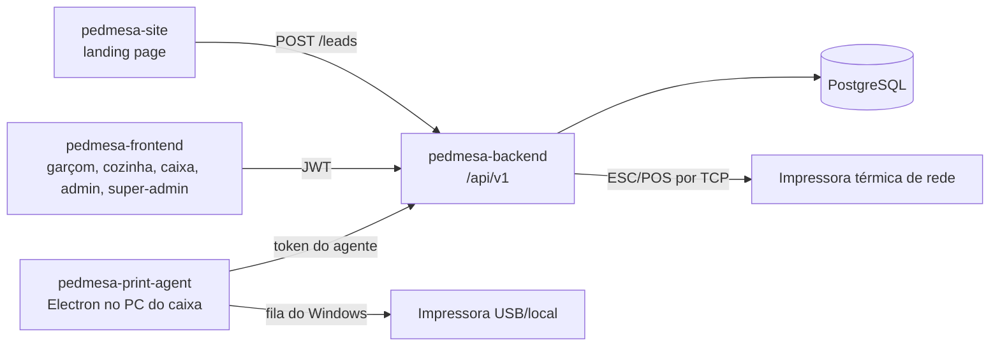
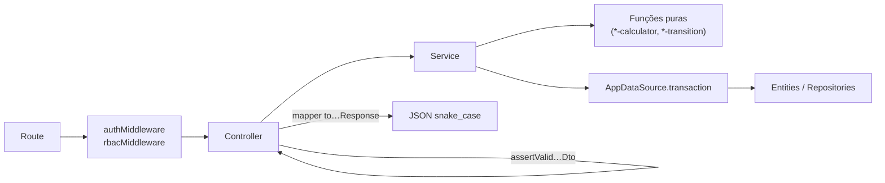

# Arquitetura — pedmesa-backend

> Estado descrito: branch `main`. Funcionalidades que ainda estão em branches de épico aparecem em `docs/ANDAMENTO.md`.

## 1. Stack

| Camada       | Tecnologia                                              |
| ------------ | ------------------------------------------------------- |
| Runtime      | Node.js 26 (CI)                                         |
| Linguagem    | TypeScript 5 com `strict`, compilado para CommonJS      |
| HTTP         | Express 4, `cors`                                       |
| Persistência | TypeORM 0.3 sobre PostgreSQL 16, migrations versionadas |
| Autenticação | JWT (`jsonwebtoken`), senhas com `bcryptjs`             |
| Qualidade    | Biome, Vitest, Supertest, Husky e Commitlint            |

## 2. Visão de sistema



Cada estabelecimento é um **tenant**. Todas as tabelas de negócio têm `tenant_id`, e o tenant de cada requisição vem do token, nunca do corpo.

## 3. Estrutura de pastas

```text
src/
  app.ts                   # Express: middlewares, /health, /ready, routers e error handler
  server.ts                # inicializa o AppDataSource e faz o listen
  config/data-source.ts    # opções do TypeORM (entidades e migrations por glob)
  database/migrations/     # 1700000000000-*.ts em diante
  database/seeds/          # initial, delivery e super-admin
  modules/<modulo>/
    routes/                # Router do Express + middlewares de acesso
    controllers/           # valida, chama o service, responde pelo mapper
    dtos/                  # assertValid…Dto (type guards) e testes
    services/              # casos de uso; *-calculator.ts e *-transition.ts são funções puras
    mappers/               # entidade -> resposta (snake_case)
    entities/              # entidades do TypeORM
  shared/
    errors/app-error.ts
    middlewares/           # auth, rbac, permissão, super-admin, agente, error handler
    utils/                 # money, getTenantId, getUserId, isUuid, isUniqueViolation...
tests/                     # integração com Supertest (setup, helpers, suítes)
```

Módulos: `admin`, `auth`, `categorias`, `clientes`, `comandas`, `dashboard`, `delivery`, `impressao`, `leads`, `pedidos`, `produtos`, `tenants` e `usuarios`.

## 4. Camadas e fluxo de uma requisição



1. O router aplica `authMiddleware` (valida o JWT e preenche `req.user`) e `rbacMiddleware([...papéis])`.
2. O controller valida o body com o DTO validator, chama o service e responde por um mapper. Entidade nunca vai direto para o `res.json()`.
3. O service carrega os dados, chama as funções puras para decidir ou calcular e persiste. Escrita em mais de uma tabela roda numa transação única; etapas reaproveitáveis recebem o `EntityManager`.
4. Efeitos externos (fila de impressão) rodam depois do commit.
5. Erros sobem como `AppError` e são convertidos pelo `errorHandlerMiddleware`.

## 5. Modelo de dados

| Tabela                          | Entidade                      | Observação                                                                                        |
| ------------------------------- | ----------------------------- | ------------------------------------------------------------------------------------------------- |
| `tenants`                       | `Tenant`                      | status `ativo`, `suspenso`, `cancelado`; `quantidade_comandas`; dados da empresa; token do agente |
| `usuarios`                      | `User`                        | `roles` é uma lista; `pode_conceder_desconto`                                                     |
| `super_admins`                  | `SuperAdmin`                  | fora dos tenants                                                                                  |
| `audit_logs`                    | `AuditLog`                    | ações do super-admin (inclusive impersonação)                                                     |
| `categorias`, `produtos`        | `Category`, `Product`         | `precisa_preparo`, `ativo`, disponibilidade                                                       |
| `comandas`                      | `Comanda`                     | `aberta`/`fechada`; `tipo_atendimento` `mesa`/`delivery`; desconto e totais                       |
| `integrantes_comanda`           | `IntegranteComanda`           | pessoas que dividem a conta                                                                       |
| `pedidos`                       | `Pedido`                      | `status_preparo`                                                                                  |
| `itens_pedido`                  | `ItemPedido`                  | **não** `item_pedido`; status do item para o KDS                                                  |
| `logs_exclusao_item`            | `LogExclusaoItem`             | auditoria de item excluído no fechamento                                                          |
| `pagamentos_comanda`            | `PagamentoComanda`            | `pix`, `dinheiro`, `cartao_credito`, `cartao_debito`                                              |
| `impressoras`, `fila_impressao` | `Impressora`, `FilaImpressao` | jobs `pedido_cozinha` e `pre_conta`; status `pendente`, `enviado`, `falhou`                       |
| `leads`                         | `Lead`                        | contatos da landing page                                                                          |
| `clientes`, `enderecos_cliente` | `Cliente`, `EnderecoCliente`  | delivery                                                                                          |
| `taxas_entrega`                 | `TaxaEntrega`                 | **não** `taxa_entrega`; taxa por bairro                                                           |
| `entregas`                      | `Entrega`                     | `em_producao`, `pronto_para_envio`, `em_rota`, `entregue`, `cancelado`                            |
| `historico_status_entrega`      | `HistoricoStatusEntrega`      | singular; append-only (trigger recusa UPDATE e DELETE)                                            |
| `sequencias_entrega`            | — (só SQL)                    | contador do `numero_entrega`                                                                      |

- O nome da classe nem sempre bate com o da tabela: em SQL puro, confira o `@Entity("...")`.
- As tabelas do delivery usam **FKs compostas com `tenant_id`** (`(cliente_id, tenant_id)`, `(comanda_id, tenant_id)`, `(entrega_id, tenant_id)`), então o banco recusa (`23503`) linhas que misturem tenants.
- O pedido delivery é um agregado da comanda (`tipo_atendimento = delivery`), conforme a `docs/adr/001-delivery-agregado-comanda.md`.

## 6. Autenticação e autorização

- **Usuários dos tenants:** `POST /api/v1/auth/login` com `{ "email", "senha" }` devolve `{ token, usuario: { id, nome, roles } }`. O token vai em `Authorization: Bearer <token>`.
- **Super-admin:** o mesmo login reconhece o super-admin e devolve um token assinado com `SUPER_ADMIN_JWT_SECRET`; as rotas `/admin` usam `superAdminAuthMiddleware`.
- **Agente de impressão:** `GET /impressao/pendentes` e `PATCH /impressao/:id/status` usam `agentAuthMiddleware`, com o token do agente gerado em `POST /tenants/token-agente`.
- Toda escrita autenticada é registrada pelo `authMiddleware` quando há impersonação (auditoria).

### Matriz de acesso (`/api/v1`)

| Recurso                                                                 | admin | caixa | garcom | cozinha | Outro                                     |
| ----------------------------------------------------------------------- | :---: | :---: | :----: | :-----: | ----------------------------------------- |
| `POST /auth/login`                                                      |       |       |        |         | público                                   |
| `POST /leads`                                                           |       |       |        |         | público                                   |
| `/admin/*`                                                              |       |       |        |         | super-admin                               |
| `GET /categorias`                                                       |   ✓   |   ✓   |   ✓    |         |                                           |
| `POST /categorias`                                                      |   ✓   |       |        |         |                                           |
| `GET /produtos`                                                         |   ✓   |   ✓   |   ✓    |    ✓    |                                           |
| `PATCH /produtos/:id/disponibilidade`                                   |   ✓   |       |        |    ✓    |                                           |
| `POST`, `PUT`, `DELETE /produtos`                                       |   ✓   |       |        |         |                                           |
| `POST`, `GET /comandas`, `POST /comandas/juntar`, integrantes e extrato |   ✓   |   ✓   |   ✓    |         |                                           |
| Pagamentos, desconto, pré-conta e fechamento da comanda                 |   ✓   |   ✓   |        |         | desconto exige `pode_conceder_desconto`   |
| `POST /comandas/:id/cancelar`                                           |   ✓   |   ✓   |   ✓    |         |                                           |
| `POST /comandas/:comandaId/pedidos`                                     |   ✓   |       |   ✓    |         |                                           |
| `GET /pedidos`, `PATCH /pedidos/itens/:itemId/status`                   |   ✓   |       |   ✓    |    ✓    |                                           |
| `DELETE /pedidos/itens/:itemId`                                         |   ✓   |   ✓   |        |         | exige permissão de exclusão no fechamento |
| `DELETE /pedidos/:id`                                                   |   ✓   |       |   ✓    |         |                                           |
| `GET /dashboard`, `/usuarios/*`, `/impressao/impressoras`               |   ✓   |       |        |         |                                           |
| `GET /tenants/me`                                                       |   ✓   |   ✓   |   ✓    |    ✓    |                                           |
| `PATCH /tenants/configuracoes`, `POST /tenants/token-agente`            |   ✓   |       |        |         |                                           |
| `GET /impressao/pendentes`, `PATCH /impressao/:id/status`               |       |       |        |         | token do agente                           |

## 7. Regras de negócio implementadas

- **Comanda:** o `numero_comanda` deve ser menor ou igual ao `quantidade_comandas` do tenant e único entre as comandas `aberta`. Comanda fechada não aceita alteração.
- **Status do item** (`item-status-transition.ts`, tabela `TRANSICOES_VALIDAS`):

  | De           | Para                              |
  | ------------ | --------------------------------- |
  | `pendente`   | `em_preparo`, `cancelado`         |
  | `em_preparo` | `pendente`, `pronto`, `cancelado` |
  | `pronto`     | `em_preparo`, `entregue`          |
  | `entregue`   | `pronto`                          |
  | `cancelado`  | `pendente`                        |

- **Desconto:** percentual ou valor fixo, só por usuário com `pode_conceder_desconto` (`desconto-calculator.ts`).
- **Extrato e fechamento:** divisão entre itens individuais e compartilhados, cota por integrante e total final calculados em funções puras (`extrato-calculator.ts`, `fechamento-calculator.ts`), sempre em centavos.
- **Dinheiro:** `toCents`/`fromCents` em toda aritmética.
- **Tenant suspenso ou cancelado** não consegue logar (403).
- **Impressão:** lançar um pedido enfileira um job `pedido_cozinha` na `fila_impressao` (`PrintQueue.enqueuePedidoCozinha`); a pré-conta gera `pre_conta`. Para impressora de rede, o `PrintQueue` tenta até 3 vezes antes de marcar `falhou`.

## 8. Erros e observabilidade

- `AppError(mensagem, status)` para erros de negócio (400, 401, 403, 404, 409); o `errorHandlerMiddleware` converte em `{ message }`. Erro inesperado responde 500 sem expor stack.
- `GET /health`: o processo está vivo (não consulta o banco). `GET /ready`: executa `SELECT 1` e responde 503 se o banco não responder. O deploy e o monitoramento usam essas rotas.
- O cabeçalho `X-Powered-By` é desligado.

## 9. Diretrizes arquiteturais

As regras completas (camadas, funções puras, transações, tenant, dinheiro, migrations e testes) estão em `.agents/AGENTS.md`, seção 8, e valem para pessoas e agentes de IA.

## 10. Limitações conhecidas

- `docs/api-endpoints.md` e `docs/banco-de-dados.md` são do planejamento inicial e estão desatualizados.
- Services que acessam o banco não têm testes automatizados; a suíte de integração (`tests/`) cobre por enquanto infraestrutura e saúde, e é o lugar para novos testes de fluxo.
- Fuso horário entre Node e Postgres ainda não padronizado (PED-114).
- No extrato, a cota compartilhada por pessoa usa `Math.round`, então a soma das cotas pode diferir do total em alguns centavos (ex.: R$ 10,00 entre 3 pessoas).
- O backend não tem Dockerfile próprio nem pipeline de deploy (PED-117 e PED-119).

## 11. Setup local e fluxo de trabalho

Setup, variáveis e testes: `README.md`. Fluxo de branches: `docs/GITFLOW.md`. Pipelines: `docs/CICD.md`.
