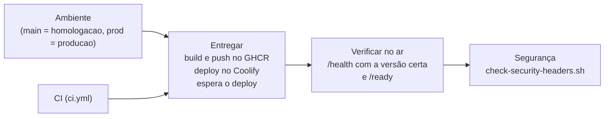

# CI/CD — pedmesa-backend

## 1. Visão geral

| Arquivo                             | Quando roda                                                                        | O que faz                                                                                                      |
| ----------------------------------- | ---------------------------------------------------------------------------------- | -------------------------------------------------------------------------------------------------------------- |
| `.github/workflows/ci.yml`          | Pull Request para `main` ou `prod`, chamado pelo deploy (`workflow_call`) e manual | Jobs **Qualidade**, **Testes** e **Commits**                                                                   |
| `.github/workflows/deploy.yml`      | push em `main` (homologação) ou `prod` (produção), e manual                        | CI → imagem no GHCR → deploy no Coolify → **verificação no ar** → verificação de segurança                     |
| `.github/dependabot.yml`            | agenda do Dependabot                                                               | npm (semanal, minor e patch agrupados), GitHub Actions (mensal) e imagem Docker (semanal, sem major do Node)   |
| `Dockerfile` + `entrypoint.sh`      | build da imagem                                                                    | Node 26, usuário `node`, `HEALTHCHECK` em `/health`, migrations antes de subir a API                           |
| `scripts/coolify-deploy.sh`         | job **Entregar**                                                                   | pede o deploy (`POST /api/v1/deploy`), espera terminar e, se falhar, explica a causa e mostra o log do Coolify |
| `scripts/verificar-no-ar.sh`        | job **Verificar no ar**                                                            | confere se a API responde e se a versão no ar é o commit publicado                                             |
| `scripts/check-security-headers.sh` | job **Segurança** do deploy, ou manual                                             | confere os cabeçalhos de segurança, compressão e IP privado (PED-120)                                          |

### Jobs do `ci.yml`

| Job           | Passos                                                                                                    |
| ------------- | --------------------------------------------------------------------------------------------------------- |
| **Qualidade** | `npm ci`, `npm run check` (tsc do código e dos testes, Biome com `--error-on-warnings`) e `npm run build` |
| **Testes**    | Postgres 16 como serviço (`pedmesa_test`), `npm ci` e `npm test` (unitários e integração)                 |
| **Commits**   | Commitlint em todos os commits do PR (pulado nos PRs do Dependabot)                                       |

Os nomes **Qualidade**, **Testes** e **Commits** são os checks exigidos na proteção de branch: não os renomeie sem atualizar a proteção.

### Jobs do `deploy.yml`



- A imagem vai para `ghcr.io/samuelramossantos/pedmesa-backend` com as tags `<ambiente>` (`homologacao` ou `producao`), `sha-<commit>` e, em produção, `latest`.
- O Coolify puxa a tag do ambiente. O job espera o deploy chegar a `finished`; se o Coolify reportar `failed`, o job mostra a causa provável e as últimas linhas do log do deploy (no log do job e no resumo do run).
- **Verificar no ar** é a última etapa e roda mesmo se a entrega falhar: confere que `/health` responde com `versao` igual ao commit publicado (o commit entra na imagem pelo build arg `GIT_SHA`) e que `/ready` responde 200. Se a versão no ar for outra, o deploy não trocou o container e o pipeline falha dizendo isso.
- Os erros aparecem como anotações no topo do run e no resumo de cada job, com a explicação e o que corrigir.
- O job **Segurança** roda em modo `report` (só lista os problemas no resumo do job) até a PED-59, a PED-64 e a PED-69 estarem concluídas. Depois, crie a variável de repositório `CHECK_MODE=enforce` para o pipeline falhar em qualquer regressão.

## 2. Ambientes

| Ambiente      | Branch | Endereço                         | Banco                  | Imagens (R2)                                     |
| ------------- | ------ | -------------------------------- | ---------------------- | ------------------------------------------------ |
| `homologacao` | `main` | `https://api-dev.pedmesa.com.br` | Postgres de dev na VPS | `pedmesa-imagens-dev` / `cdn-dev.pedmesa.com.br` |
| `producao`    | `prod` | `https://api.pedmesa.com.br`     | Postgres de produção   | `pedmesa-imagens` / `cdn.pedmesa.com.br`         |

As **migrations rodam no start do container** (`entrypoint.sh`): o deploy nunca sobe código novo sobre um banco sem as colunas que ele espera. Se uma migration falhar, o container para e o Coolify mantém a versão anterior no ar.

## 3. Configuração manual (uma vez)

### 3.1 Coolify — para cada aplicação (API de homologação e de produção)

1. **Trocar o build pack:** _Configuration_ > _General_ > _Build Pack_ = **Docker Image**; imagem `ghcr.io/samuelramossantos/pedmesa-backend`, tag `homologacao` (ou `producao`). Porta exposta: **3000**. O Nixpacks deixa de ser usado.
2. **Credencial do GHCR (imagens privadas):** no GitHub, crie um token clássico só com `read:packages` (_Settings_ > _Developer settings_ > _Personal access tokens_). No servidor do Coolify, faça login no registry uma vez:

   ```bash
   docker login ghcr.io -u SamuelRamosSantos   # senha = o token read:packages
   ```
3. **Variáveis de ambiente** da API: as do `.env.example` (banco, JWT, CORS, rate limit e as `R2_*` do bucket do ambiente). Sem as `R2_*`, a API não sobe.
4. **Health check:** pode ficar ligado no Coolify em `/health`, porta 3000 (a imagem também declara o seu `HEALTHCHECK`).
5. **Desligar o deploy automático por push no Coolify:** quem dispara o deploy agora é o GitHub Actions.
6. **Anotar o UUID da aplicação:** aparece na URL da aplicação no painel do Coolify.
7. **Token de API do Coolify:** _Keys & Tokens_ > _API tokens_ > criar um token com as permissões **`read`** e **`deploy`**: `deploy` dispara o deploy e `read` deixa o pipeline acompanhar o andamento e mostrar o log do Coolify quando falhar. Sem `read`, o deploy é disparado, mas sem acompanhamento (o pipeline avisa e confia na etapa **Verificar no ar**). Um token serve para todas as aplicações.

### 3.2 GitHub — em cada repositório

1. **Environments** (_Settings_ > _Environments_): criar `homologacao` e `producao`. Em produção, opcionalmente _Required reviewers_ (o deploy espera a sua aprovação).
2. **Em cada environment:**

   | Tipo     | Nome               | Exemplo (homologação)               |
   | -------- | ------------------ | ----------------------------------- |
   | Variable | `COOLIFY_URL`      | `https://coolify.seudominio.com.br` |
   | Variable | `COOLIFY_APP_UUID` | UUID da aplicação no Coolify        |
   | Variable | `APP_URL`          | `https://api-dev.pedmesa.com.br`    |
   | Secret   | `COOLIFY_TOKEN`    | token de API do Coolify             |

   `vars.*` são **Variables** e `secrets.*` são **Secrets**: um valor cadastrado no lugar errado não é lido. Sem essas variáveis, o deploy só publica a imagem e avisa que nada foi implantado.
3. **Branch protection** (_Settings_ > _Branches_) em `main` e `prod`: Pull Request obrigatório, status checks **Qualidade**, **Testes** e **Commits**, e revisão dos code owners (`* @SamuelRamosSantos`).
4. **Code security:** ativar _Dependabot alerts_ e _Dependabot security updates_.
5. **Variável de repositório `CHECK_MODE`:** deixar sem (modo `report`) até a PED-59/64/69; depois, `enforce`.

## 4. Rodar a imagem localmente

```bash
docker build -t pedmesa-api:local .
docker run --rm -p 3000:3000 --env-file .env pedmesa-api:local
```

Com o `.env` de desenvolvimento, o container aplica as migrations no banco de dev da VPS antes de subir. Para não tocar nele, aponte para o banco de testes do `docker-compose.test.yml` (`DB_HOST=host.docker.internal`, `DB_PORT=5433`).

## 5. `/health` e `/ready`

| Rota          | Responde                                                                                  | Uso                                        |
| ------------- | ----------------------------------------------------------------------------------------- | ------------------------------------------ |
| `GET /health` | 200 enquanto o processo está de pé, com `versao` (commit da imagem); não consulta o banco | liveness e conferência da versão no deploy |
| `GET /ready`  | 200 com `SELECT 1` no banco; 503 se o banco não responder                                 | readiness (fim do deploy)                  |

## 6. Rollback

Toda imagem publicada fica com a tag `sha-<commit>`. Para voltar uma versão: no Coolify, troque a tag da aplicação para o `sha-<commit>` anterior e faça _Redeploy_; ou rode o `deploy.yml` manualmente a partir de um commit anterior. Atenção: migrations já aplicadas não são desfeitas pelo rollback da imagem.

## 7. Verificação de segurança à mão

```bash
bash scripts/check-security-headers.sh https://api.pedmesa.com.br api
CHECK_MODE=enforce bash scripts/check-security-headers.sh https://api.pedmesa.com.br api   # sai com 1 se houver problema
```

Os domínios passam pelo proxy da Cloudflare (`Server: cloudflare`): cabeçalhos, compressão e o `Server` também dependem da configuração da Cloudflare, não só da API.

## 8. Problemas comuns

- **Testes recusam rodar com `[trava de testes]`:** o `DB_NAME` não termina em `_test`, o `DB_HOST` não é local ou falta o `.env.test`. É proposital; veja o README.
- **Vitest falha com `Cannot read properties of undefined (reading 'config')` no Windows:** o terminal está num caminho com a letra do drive minúscula (`d:/...`, comum no Git Bash). Rode pelo PowerShell ou a partir de `D:\...`.
- **Job Commits falha:** alguma mensagem do PR está fora de `tipo(escopo): [PED-<ID>] descrição` ou passa de 100 caracteres.
- **Deploy publica a imagem mas avisa que nada foi implantado:** faltam `COOLIFY_URL`, `COOLIFY_APP_UUID` ou `COOLIFY_TOKEN` no environment.
- **`Método não aceito (405)`:** o Coolify só aceita `POST` em `/api/v1/deploy` (é o que o script usa); se aparecer, o `COOLIFY_URL` não aponta para o painel do Coolify.
- **`COOLIFY_URL deve ser só o endereço do painel`:** cadastre só `https://seu-coolify`, sem `/api/v1` nem parâmetros.
- **`Token do Coolify sem permissão de leitura`:** o token tem só `deploy`; gere um com `read` e `deploy` e atualize o secret `COOLIFY_TOKEN`.
- **`COOLIFY_APP_UUID com a URL do webhook`:** a variável recebeu a URL do _Deploy Webhook_; o pipeline extrai o UUID, mas corrija a variável para conter só ele.
- **`a versão no ar é X, esperada Y`:** o Coolify terminou, mas o container antigo continua rodando; confira se a aplicação está como _Docker Image_ com a tag do ambiente.
- **Coolify não consegue puxar a imagem (`unauthorized`):** falta o `docker login ghcr.io` no servidor, ou o token não tem `read:packages`.
- **Container reinicia em loop logo depois do deploy:** veja o log no Coolify. Causas comuns: variável `R2_*` faltando (a API recusa subir) ou migration falhando no `entrypoint.sh`.
